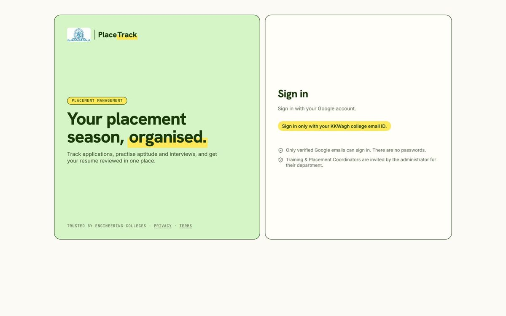
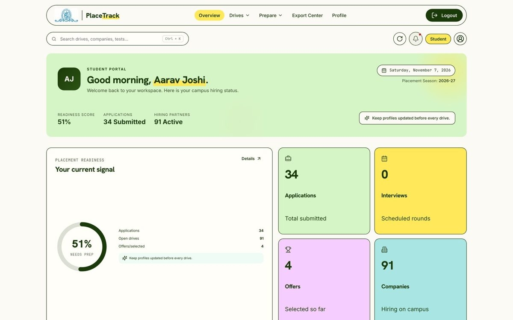
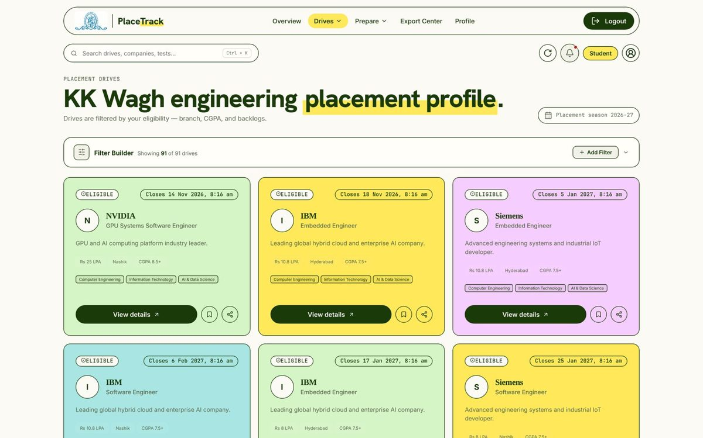
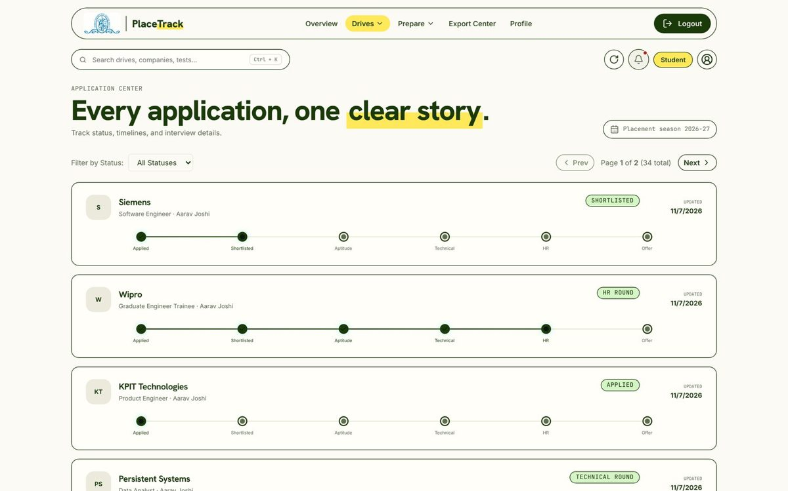
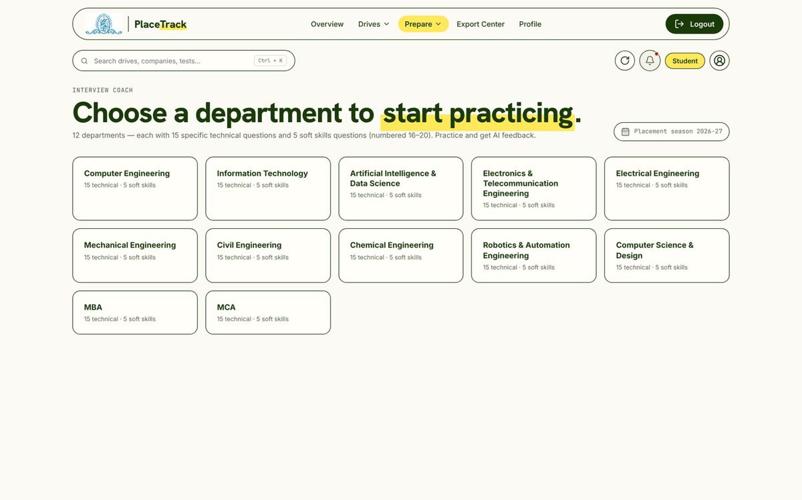
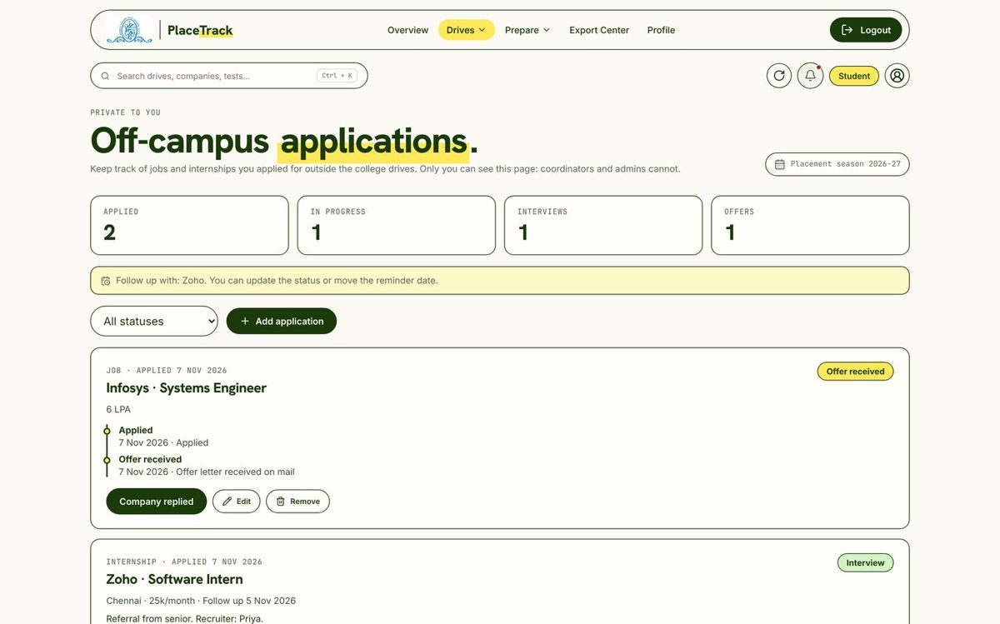
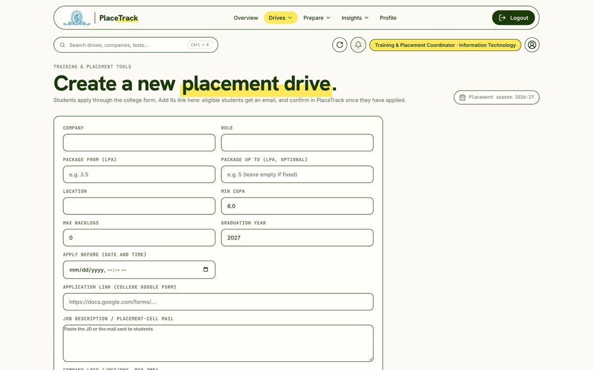
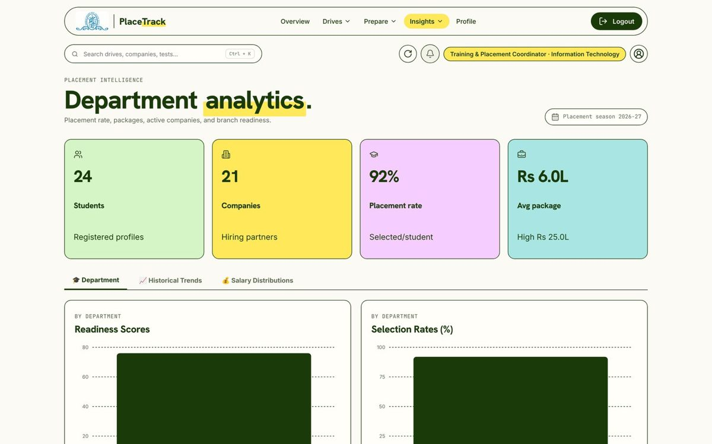
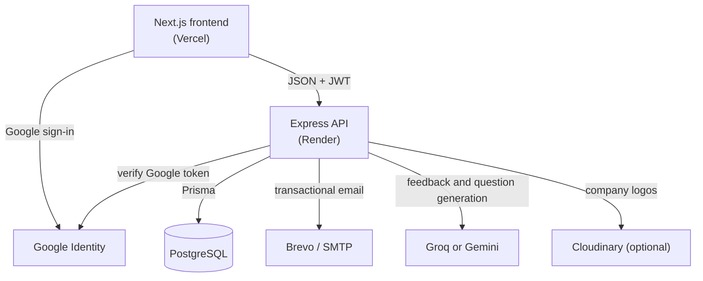

<div align="center">

# PlaceTrack AI

**One platform for the whole campus placement season.**

Drives, eligibility, applications, readiness and reports for engineering colleges, in one place.

[](https://placetrack-ai.vercel.app)
[](https://nextjs.org/)
[](https://react.dev/)
[](https://www.typescriptlang.org/)
[](https://expressjs.com/)
[](https://www.prisma.io/)
[](LICENSE)

[Live demo](https://placetrack-ai.vercel.app) · [Features](#features) · [Architecture](#architecture) · [Getting started](#getting-started) · [API](#api-overview) · [Deployment](#deployment)

</div>

---

## Overview

Most placement cells run on WhatsApp groups and spreadsheets. Drive details get lost, eligibility is checked by hand, nobody knows who actually applied on the company form, and the numbers are put together at the end of the season.

PlaceTrack AI moves that work into one system:

1. A coordinator publishes a drive once, with package, location, eligible departments and deadline.
2. Every eligible student gets an email. Students only see drives they qualify for.
3. Students apply on the company's own form, then confirm **"I have applied"** in PlaceTrack.
4. The placement cell tracks every application through shortlisting, interviews and selection, and exports reports at any time.

Students also get a resume score, aptitude mock tests, interview practice and a private tracker for off-campus applications.

It is built for KKWagh (KKWIEER) and is running now. Sign-in is Google only, and student sign-in can be limited to the college domain.

## Screenshots

> All screenshots use demonstration data. No real student data appears.

| Sign in | Student home |
|:--:|:--:|
|  |  |

| Opportunities | Applications |
|:--:|:--:|
|  |  |

| Interview practice | Off-campus tracker |
|:--:|:--:|
|  |  |

| Drive creator (coordinator) | Analytics (coordinator) |
|:--:|:--:|
|  |  |

## Features

### Students
- **Eligible drives only.** Branch, CGPA, backlogs and batch are checked automatically, with a suitability score per drive.
- **Application tracking.** A timeline for every application, from applied to selected, plus deadline reminders and in-app notifications.
- **External apply flow.** Apply on the company's own form, then confirm in the app.
- **Readiness score.** A transparent 0-100 score built from academics, aptitude, practice, projects, internships, skills and backlogs.
- **Resume analysis.** Upload a PDF or DOCX and get a score based on what is actually written in it.
- **Aptitude mock tests.** Timed tests with answer review and section-wise results.
- **Interview practice.** Technical and soft-skill questions for every department, with feedback on your answer.
- **Off-campus tracker.** A private list of outside jobs and internships. Coordinators and admins cannot see it.
- **Profile card export.** Download a shareable PNG of your readiness profile.

### Coordinators (Training & Placement Coordinator, one department each)
- **Drives.** See every drive of the department, create new ones (single package or a range such as 3.5-5 LPA) and delete them.
- **Students.** Add a student, edit details, remove a student, import a list from **Excel or CSV** (with a template) and export the list.
- **Applications.** Move applications through the pipeline and schedule interviews.
- **Mock tests.** Upload aptitude tests from an Excel template.
- **Reports.** Export students, applications, drives and a placement summary as CSV or PDF. Everything is limited to the coordinator's own department.
- **Analytics.** Placement rate, package statistics and department charts.

### Admin (Training & Placement Officer)
- Everything a coordinator can do, across **all** departments.
- **Invite coordinators** by email and assign them a department. Coordinators are never self-registered.
- Manage users, load the starter question bank and review the audit trail.

### Access at a glance

| | Student | Coordinator | Admin |
|---|:-:|:-:|:-:|
| See eligible drives | ✅ | own department | all |
| Apply and track applications | ✅ | | |
| Create and delete drives | | own department | all |
| Add, import, edit and remove students | | own department | all |
| Export students, drives and applications | | own department | all |
| Invite coordinators and manage users | | | ✅ |
| Private off-campus tracker | ✅ (only the student) | | |

## Architecture



**How sign-in works.** The browser gets a Google ID token. The API verifies it, then issues its own signed JWT (12 hours) that carries the user id and role. No passwords are stored. Roles are checked on the server for every request, and a coordinator's department scope is applied to every query, not only hidden in the UI.

### Tech stack

| Layer | Choice |
|---|---|
| Frontend | Next.js 15 (App Router), React 19, TypeScript, plain CSS variables, Recharts, Framer Motion |
| Backend | Node.js 20+, Express 5, TypeScript, Zod validation |
| Database | PostgreSQL through Prisma 6 |
| Auth | Google Sign-In, JWT, role-based access control |
| Email | Brevo HTTPS API, or any SMTP server through Nodemailer |
| AI | Groq (preferred) or Google Gemini for interview feedback and question generation. Resume scoring is deterministic and does not use an LLM. |
| Files | Excel/CSV parsing with ExcelJS, PDF and DOCX resume parsing, PDF reports with jsPDF |
| Tests | Jest and Supertest |

### Project structure

```text
.
├── backend/
│   ├── prisma/                  # schema.prisma and the demo seed script
│   ├── src/
│   │   ├── lib/                 # config, Prisma client, Google verification, department scope, audit log
│   │   ├── middleware/          # authentication, role guards, rate limiting, error handler
│   │   ├── routes/              # auth, drives, applications, tests, reports, ai, off-campus, ...
│   │   ├── services/            # eligibility, readiness, resume scoring, mail, imports
│   │   └── jobs/                # daily deadline reminders
│   └── tests/                   # Jest integration and unit tests
├── frontend/
│   └── src/
│       ├── app/                 # routes: landing, login, practice, privacy, terms
│       ├── components/          # dashboard views and shared UI
│       └── lib/                 # API client, departments, helpers
├── docs/screenshots/            # README images (demo data)
└── docker-compose.yml           # local PostgreSQL
```

## How the scores work

### Placement eligibility
A student can apply only if all four checks pass: CGPA at or above the drive minimum, active backlogs within the limit, department in the allowed list, and the right graduation year. Eligible students get a suitability score from 50 to 100 using the CGPA margin (up to 15), skill overlap with the role description (up to 30) and department specificity (up to 15).

### Readiness score (0-100)

| Part | Points |
|---|---|
| Academics | CGPA / 10 x 30 (max 30) |
| Aptitude | average mock-test accuracy x 0.25 (max 25) |
| Practice | 1 point per mock test, up to 5 tests (max 5) |
| Projects | 5 per project, up to 3 (max 15) |
| Internships | 7.5 per internship, up to 2 (max 15) |
| Skills | 1.25 per skill, up to 8 (max 10) |
| Backlogs | minus 5 per active backlog, at most minus 20 |

80 and above is **Placement Ready**, 65 to 79 is **Nearly Ready**, below 65 is **Needs Preparation**. Every input comes from something the student actually did or entered.

### Resume score (0-100)
Measured from the extracted text only: contact and links (10), education (15), technical skills (20), projects (20), experience (15), certifications and achievements (10), and impact and writing quality (10). A document that does not look like a resume cannot score well, and keyword stuffing cannot reach 100.

## API overview

All routes are under `/api`. Protected routes need `Authorization: Bearer <jwt>`. `GET /health` reports database connectivity.

| Area | Endpoints | Who |
|---|---|---|
| Auth | `POST /auth/google`, `GET /auth/me`, `PATCH /auth/profile` | Public, then any user |
| Students | `GET/POST /auth/students`, `PATCH/DELETE /auth/students/:id`, `GET /auth/students/template`, `POST /auth/bulk-import` | Coordinator, Admin |
| Users | `GET/PATCH/DELETE /auth/users`, `POST /auth/users/tpc` | Admin |
| Drives | `GET /drives`, `GET /drives/search`, `POST/PATCH/DELETE /drives` | Any user to read, Coordinator or Admin to write |
| Applications | `GET/POST /applications`, `PATCH /applications/:id/status`, `POST /applications/:id/interview` | Student applies, Coordinator or Admin manages |
| Aptitude tests | `GET /tests`, `POST /tests/:id/submit`, `POST /tests/import`, `GET /tests/template` | Students take, Coordinator or Admin manage |
| Practice questions | `GET /questions`, `POST /questions/generate`, `POST /questions/:id/attempt` | Any user |
| AI | `POST /ai/resume/upload`, `POST /ai/resume/text`, `POST /ai/interview/feedback` | Any user |
| Off-campus | `GET/POST/PATCH/DELETE /off-campus` | Student only |
| Reports | `/reports/students`, `/applications`, `/drives` (`.csv` or `.json`), `/reports/summary.json`, `/reports/analytics`, `/reports/department-overview` | Coordinator, Admin |
| Other | `GET /dashboard`, `GET/PATCH /notifications`, `GET /public/stats` | Varies |

## Getting started

### Prerequisites
- Node.js 20 or newer
- Docker (for a local PostgreSQL), or any PostgreSQL database
- A Google OAuth client ID (Google Cloud Console, "Web application")

### 1. Install

```bash
git clone https://github.com/sanket1035/placetrack-ai.git
cd placetrack-ai
npm install
```

### 2. Configure

```bash
cp backend/.env.example backend/.env
cp frontend/.env.example frontend/.env.local
```

In the Google Cloud Console, add `http://localhost:3000` as an authorised JavaScript origin, then set the client id in both files.

**Backend (`backend/.env`)**

| Variable | Purpose |
|---|---|
| `DATABASE_URL`, `DIRECT_URL` | PostgreSQL connection strings (pooled and direct) |
| `JWT_SECRET` | Signing key for session tokens. Use 32+ random characters in production. |
| `GOOGLE_CLIENT_ID` | Your Google OAuth client id |
| `ADMIN_EMAILS` | Comma-separated emails that become **Admin** on first sign-in |
| `ALLOWED_STUDENT_EMAIL_DOMAINS` | Optional. For example `kkwagh.edu.in` limits student sign-in to the college domain. Leave empty to allow any Google account. |
| `FRONTEND_URL` | Allowed CORS origin and the base URL for email links |
| `GROQ_API_KEY` or `GEMINI_API_KEY` | AI provider for interview feedback and question generation (optional) |
| `BREVO_API_KEY` or `SMTP_HOST`, `SMTP_PORT`, `SMTP_USER`, `SMTP_PASS` | Email delivery (optional) |
| `EMAIL_FROM` | Sender shown on emails, for example `PlaceTrack AI <no-reply@example.com>` |
| `CLOUDINARY_*` | Optional, for company logo uploads |
| `AUTO_SEED` | `true` fills an **empty** database with demo data on first start |
| `SHOW_PUBLIC_STATS` | `true` shows real aggregate numbers on the landing page |
| `TRUST_PROXY_HOPS` | Number of reverse proxies in front of the API (default `1`) |

**Frontend (`frontend/.env.local`)**

| Variable | Purpose |
|---|---|
| `NEXT_PUBLIC_API_URL` | Backend base URL, for example `http://localhost:4000` |
| `NEXT_PUBLIC_GOOGLE_CLIENT_ID` | The same Google OAuth client id |
| `NEXT_PUBLIC_CONTACT_EMAIL` | Optional, shown on the landing page |

### 3. Database

```bash
docker compose up -d                 # local PostgreSQL
npm run prisma:push -w backend       # create the tables
```

Optional demo data: set `AUTO_SEED=true` before the first start, or run `npm run prisma:seed -w backend`.

### 4. Run

```bash
npm run dev
```

| Service | URL |
|---|---|
| Frontend | http://localhost:3000 |
| API | http://localhost:4000 |
| Health | http://localhost:4000/health |

Sign in with the Google account listed in `ADMIN_EMAILS` to get the admin console. Invite a coordinator from **Users**, and they sign in with the invited email.

## Testing

```bash
npm run typecheck        # backend and frontend
npm test                 # backend Jest suite
```

The integration tests need a **separate, disposable** PostgreSQL database. Set `TEST_DATABASE_URL` in `backend/.env` before running them. They empty their tables.

## Deployment

| Part | Where | Notes |
|---|---|---|
| Frontend | Vercel | Root directory `frontend`. Set `NEXT_PUBLIC_API_URL` and `NEXT_PUBLIC_GOOGLE_CLIENT_ID`. |
| API | Render (or any Node host) | Build `npm install && npm run build -w backend`, start `npm run start -w backend`. Set the backend variables above. |
| Database | Any managed PostgreSQL | Run `npm run prisma:push -w backend` once against it. |

Tips:
- Free hosts that block outbound SMTP ports work fine with **Brevo's HTTPS API**: set `BREVO_API_KEY`.
- Free API tiers go to sleep when idle. Point an uptime monitor at `/health` to keep the first request fast.
- Add your deployed frontend URL as an authorised JavaScript origin in the Google OAuth client.

## Security

- Google sign-in only. The ID token is verified on the server and no passwords are stored.
- Role-based access control on every route, with **department scoping** applied to queries for coordinators.
- Coordinators are invited by an admin. They cannot self-register.
- A student's off-campus tracker is visible only to that student.
- Zod validation on request bodies, Helmet headers and rate limiting (300 requests per minute per IP on `/api`).
- Resume files are processed in memory and not written to disk.
- An audit log records sensitive actions such as imports, exports and deletions.
- Privacy Policy and Terms of Use pages are part of the app.

## Contributing

Issues and pull requests are welcome. Please read [CONTRIBUTING.md](CONTRIBUTING.md) and the [Code of Conduct](CODE_OF_CONDUCT.md) first, and open a pull request instead of pushing to `main`.

## License

[MIT](LICENSE) © [Sanket Chaudhari](https://github.com/sanket1035)
